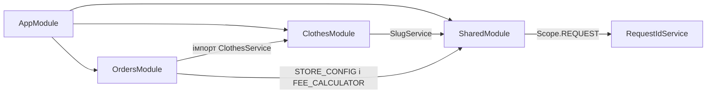
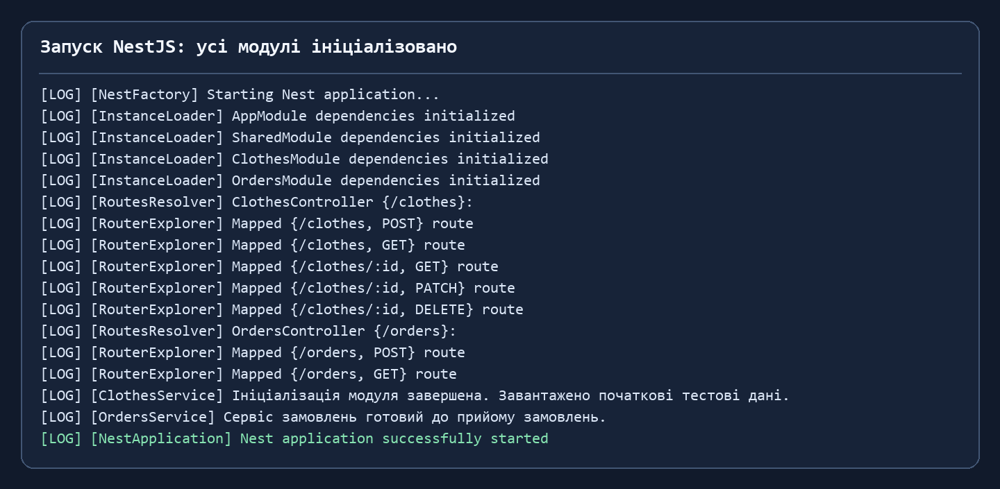
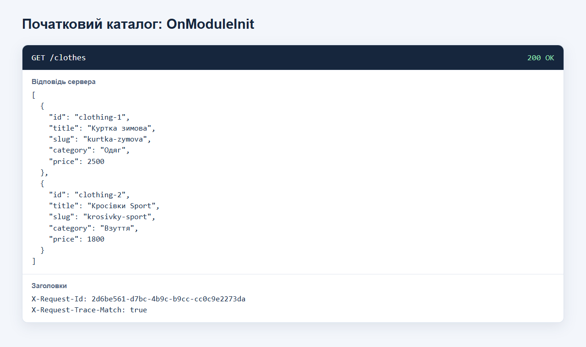
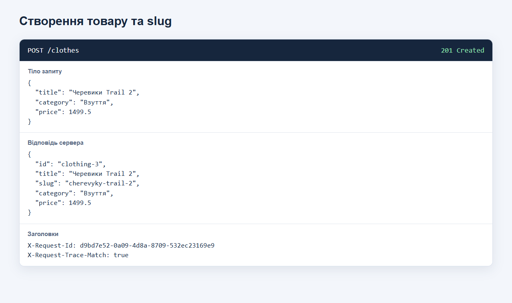
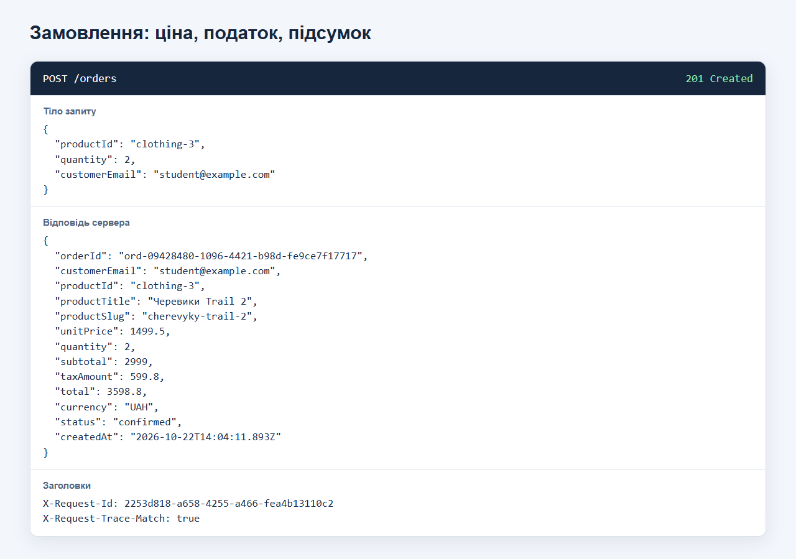
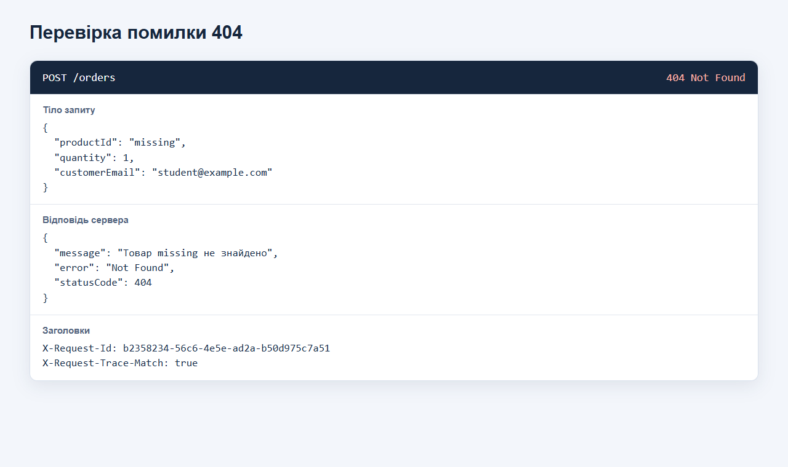
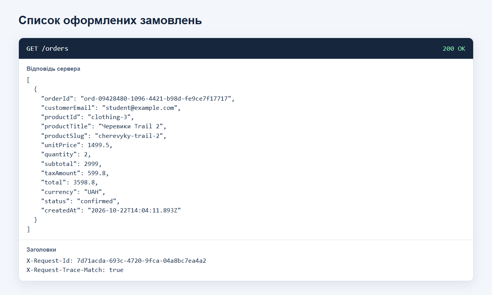
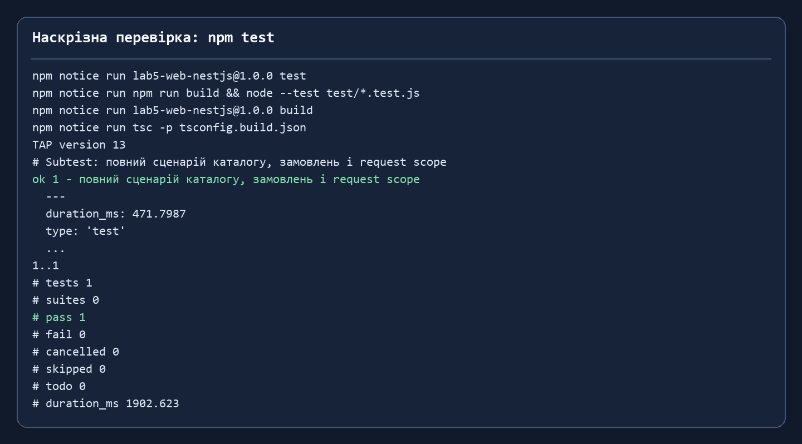

# Практична робота №5 — модульна архітектура та DI у NestJS

**Варіант 3:** одяг та взуття (`/clothes`). Проєкт продовжує REST API з практичної №4 і реалізує всі три рівні завдання: каталог, замовлення, спільні провайдери, хуки життєвого циклу та перевірку областей видимості.

Готовий звіт із титульною сторінкою, скриншотами, висновком і відповідями на контрольні питання: [Практична_робота_5_Ткаченко_ВМ.pdf](report/Практична_робота_5_Ткаченко_ВМ.pdf).

## Запуск

Потрібні Node.js 20+ і npm. Перевірено на Node.js 22.23.3.

```bash
npm ci
npm run build
npm start
```

API працює на `http://localhost:3000`. Для автоматичної наскрізної перевірки:

```bash
npm test
```

Сценарії REST Client містяться у [requests.http](requests.http). Дані зберігаються у пам’яті та скидаються після перезапуску.

## Архітектура



- `ClothesModule` інкапсулює контролер і сервіс каталогу та експортує `ClothesService` для замовлень.
- `OrdersModule` використовує `ClothesService.findOne()` для перевірки товару й актуальної ціни. Замовлення зберігаються в окремому in-memory списку.
- `SharedModule` експортує `SlugService`, `STORE_CONFIG` (`useValue`), `FEE_CALCULATOR` (`useFactory` з `inject: [STORE_CONFIG]`) та провайдери трасування запитів.
- `ClothesService` і `OrdersService` реалізують `OnModuleInit`. Каталог додає два початкові товари, а обидва сервіси виводять повідомлення про готовність.
- `RequestIdService` має `Scope.REQUEST`. Контролер і `RequestTraceService` отримують однаковий ID всередині одного запиту; наступний HTTP-запит отримує інший ID. Заголовки `X-Request-Id` та `X-Request-Trace-Match` дають це перевірити. Стан каталогу та замовлень лишається у singleton-сервісах.

## Маршрути

| Метод | Шлях | Результат |
|---|---|---|
| `GET` | `/clothes` | Список товарів; `search` і `limit` — необов’язкові параметри |
| `GET` | `/clothes/:id` | Один товар або `404` |
| `POST` | `/clothes` | Новий товар з автоматичним `slug`, `201` |
| `PATCH` | `/clothes/:id` | Часткове оновлення, перерахунок `slug` при зміні назви |
| `DELETE` | `/clothes/:id` | Видалення, `204` |
| `POST` | `/orders` | Замовлення з підсумком і податком, `201`; невідомий товар — `404` |
| `GET` | `/orders` | Список замовлень |

Приклад створення товару:

```json
{ "title": "Черевики Trail 2", "category": "Взуття", "price": 1499.5 }
```

Приклад замовлення після створення товару в чистому запуску:

```json
{ "productId": "clothing-3", "quantity": 2, "customerEmail": "student@example.com" }
```

Для нього `subtotal = 1499.5 × 2 = 2999`, `taxAmount = 2999 × 20% = 599.8`, `total = 3598.8 UAH`. Тіла запитів перевіряються `ValidationPipe`; некоректні дані повертають `400`.

## Перевірка роботи

Команда `npm test` збирає TypeScript і виконує один наскрізний сценарій із перевірками початкових записів, slug, пошуку, замовлення, податку, `400`, `404`, редагування, видалення та request scope. Результат: **1 тест пройшов, 0 помилок**. Окремий запуск сценарію збережено в [evidence/api-results.json](evidence/api-results.json), а журнал запуску — в [evidence/startup.log](evidence/startup.log).

Знімки фактичних відповідей API та журналів:















Знімки HTTP-відповідей створено браузером після реальних запитів до локально запущеного застосунку; знімки журналів відображають збережений вивід запуску та тесту.

## Структура проєкту

```text
src/
  app.module.ts
  main.ts
  clothes/      # сутність, DTO, контролер, сервіс, модуль
  orders/       # сутність, DTO, контролер, сервіс, модуль
  shared/       # slug, конфігурація, фабрика податку, request scope
test/api.test.js # наскрізна перевірка HTTP API
requests.http   # ручні сценарії для REST Client
evidence/       # скриншоти та збережені результати
report/         # звіт для здачі
```
